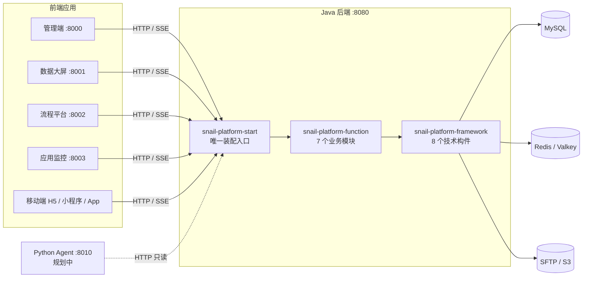

# Snail Platform

> 多租户企业级开源平台：Java 后端 + 五套前端 + Python Agent。

[](LICENSE)
[](https://adoptium.net/)
[](https://spring.io/projects/spring-boot)
[](https://vuejs.org/)
[](https://www.python.org/)
[](#贡献指南)

Snail Platform 是一个多租户企业级平台工程：Java 后端提供统一技术底座与业务模块，多套前端覆盖管理、大屏、流程、监控与移动端，Python Agent 线负责 AI 编排，仓库同时维护一套人 + AI 协同的研发流程规范。

> **快速开始**：准备 JDK 21、Maven 3.9+、MySQL 与 Redis，执行 `cd snail-platform-backend && mvn clean install`，详见 [快速开始](#快速开始)。

## 目录

- [当前状态](#当前状态)
- [功能特性](#功能特性)
- [仓库结构](#仓库结构)
- [系统组成](#系统组成)
- [架构总览](#架构总览)
- [后端架构](#后端架构)
- [技术选型](#技术选型)
- [构建护栏](#构建护栏)
- [快速开始](#快速开始)
- [配置要点](#配置要点)
- [多端协同](#多端协同)
- [验证与 CI](#验证与-ci)
- [文档索引](#文档索引)
- [路线图](#路线图)
- [贡献指南](#贡献指南)
- [安全策略](#安全策略)
- [致谢](#致谢)
- [License](#license)

## 当前状态

- **后端**：`framework` 8 个技术构件、`function` 7 个业务模块（system / auth / external / notify / storage / workflow / monitor）与唯一装配层 `start` 全部落地；Flyway 迁移 V1–V5、三份 profile 配置、ArchUnit 架构护栏与流程测试齐备，可直接 `package` 出可执行 jar 并启动。
- **前端**：5 套独立应用各具备开发与构建入口——管理端、数据大屏、流程平台、应用监控、移动端；四套桌面前端共用一套登录会话，通过一次性 `ssotoken` 跨端免登切换。
- **Agent**：FastAPI 工程骨架已落地（`/health`、可选 `X-API-Key` 服务间鉴权、生产关闭交互式文档）；LangGraph 编排、知识库、SSE 与运行审计按 `docs/Agent后端技术方案_v3.md` 推进。
- **规范**：`docs/vibecoding/devflow` 提供熟悉项目、功能开发、缺陷修复三条链路与门禁规范，配套 `scripts/validate-devflow.sh` 做结构自检。

| 子项目 | 版本 |
| --- | --- |
| 后端 / 五套前端 | `0.0.1` |
| Agent | `0.1.0` |
| 基础包名 | `com.snail.platform` |
| License | MIT |

## 功能特性

- **多租户开箱可用**：租户生命周期、五系统开通位、租户级数据隔离与平台面管理。
- **认证与权限**：图形验证码、账号/短信/钉钉/飞书/企业微信登录、JWT 会话吊销、角色菜单与数据范围。
- **流程引擎**：Flowable 8，BPMN 建模、模板/模型/实例/任务、转办撤回与流程轨迹。
- **消息与文件**：站内通知、公告扇出、SSE 实时推送、邮件短信出站；SFTP/S3 双存储与租户配额。
- **应用监控**：JVM/数据库/慢 SQL 指标、告警规则、诊断报告、日志检索与 Arthas 入口。
- **五端协同**：管理端、三维大屏、流程平台、监控端、移动端共用会话，一次性令牌免登切换。
- **工程质量**：ArchUnit 架构护栏、Flyway 版本化迁移、统一响应与分页、依赖漏洞审计。
- **开放扩展**：MIT 协议，模块化单体，可按需裁剪与二次开发。

## 仓库结构

```
snail-platform/
├── snail-platform-backend/            # Java 后端（framework / function / start）
│   ├── snail-platform-framework/      # 8 个技术基建构件
│   ├── snail-platform-function/       # 7 个业务模块
│   └── snail-platform-start/          # 唯一装配点、启动类、配置、迁移与架构测试
├── snail-platform-frontend-admin/     # 管理端            :8000
├── snail-platform-frontend-dashboard/ # 三维数据大屏       :8001
├── snail-platform-frontend-workflow/  # 流程平台           :8002
├── snail-platform-frontend-monitor/   # 应用监控（平台端）  :8003
├── snail-platform-frontend-mobile/    # 移动端（uni-app）  H5 :8003
├── snail-platform-agent/              # Python Agent 线    :8010（规划）
├── docs/                              # 技术方案、开发教程、研发流程规范
├── scripts/                           # 仓库级校验脚本
├── artifacts/                         # 交付物暂存
└── .github/workflows/                 # CI（依赖漏洞审计）
```

> `snail-platform-frontend-monitor` 与移动端 H5 的开发端口同为 `8003`，不能同时启动；需要并行调试时修改其中一端的 `vite.config.ts` 端口。

## 系统组成

| 端 | 目录 | 默认端口 | 技术栈 | 职责 |
| --- | --- | --- | --- | --- |
| 管理端 | `snail-platform-frontend-admin` | 8000 | Vue 3.5 + TypeScript + Vite 8 + Element Plus + Pinia | 登录与第三方扫码、动态菜单与按钮判权、工作台、系统管理（组织/用户/角色/字典/日志/在线会话/通知/文件）、平台管理（租户/菜单/公告/文件/第三方流水）、个人中心、系统设置、站内消息 |
| 数据大屏 | `snail-platform-frontend-dashboard` | 8001 | Vue 3.5 + Cesium + 天地图 | 三维地球、天地图影像底图、3D Tiles 模型、看板页签、天气卡片与顶栏跨端切换 |
| 流程平台 | `snail-platform-frontend-workflow` | 8002 | Vue 3.5 + Element Plus + bpmn-js | 流程工作台、BPMN 建模与发布、流程定义、实例管理、待办/已办、转办/撤回、流程轨迹 |
| 应用监控 | `snail-platform-frontend-monitor` | 8003 | Vue 3.5 + Element Plus + Sass | 运行总览、指标趋势、告警规则与告警处置、诊断报告、应用日志、慢 SQL、Arthas 在线诊断入口；仅平台管理员可用 |
| 移动端 | `snail-platform-frontend-mobile` | H5 8003 | uni-app + Vue 3.5 + wot-design-uni + Pinia | 一套代码编译 H5 / 微信小程序 / 支付宝小程序 / App；登录、工作台、消息、我的；平台差异收敛在 `src/adapter` |
| 企业门户 | 未立项 | — | — | 租户开通位（`portalEnabled`）已预留，前端尚未建设 |

租户维度有五个系统开通位：管理端、流程端、移动端、数据大屏、企业门户；应用监控为平台端专属，不设租户开关，仅平台默认租户可用。管理端顶栏按 `/me` 实时开通态过滤切换入口，数据缺失时一律隐藏。

## 架构总览



## 后端架构

后端只有三个层次，聚合根 `snail-platform-backend` 的 `<modules>` 恰好登记这三个，前端与 Agent 线不进 reactor。

| 构件 | 层次 | 职责 |
| --- | --- | --- |
| `snail-platform-framework` | 技术基建层（聚合） | 纯技术能力，不含业务逻辑 |
| &nbsp;&nbsp;├ `snail-framework-core` | 基建 | 统一响应/业务异常、`PageQuery`→`PageResult` 分页装配、租户与登录人上下文、traceId 过滤器；详见[模块说明](snail-platform-backend/snail-platform-framework/snail-framework-core/README.md) |
| &nbsp;&nbsp;├ `snail-framework-db` | 基建 | 连接与事务装配、租户行级过滤、数据范围拦截、分页上限、审计填充；方言 `DbType.MYSQL` 在此固定；详见[模块说明](snail-platform-backend/snail-platform-framework/snail-framework-db/README.md) |
| &nbsp;&nbsp;├ `snail-framework-redis` | 基建 | Lettuce 客户端装配、Redis key 约定、限流小工具；详见[模块说明](snail-platform-backend/snail-platform-framework/snail-framework-redis/README.md) |
| &nbsp;&nbsp;├ `snail-framework-security` | 基建 | JWT 签发与校验、认证过滤器与会话吊销、权限码判定入口；详见[模块说明](snail-platform-backend/snail-platform-framework/snail-framework-security/README.md) |
| &nbsp;&nbsp;├ `snail-framework-log` | 基建 | 操作日志注解与切面；不落库，经 `OperLogSink` 端口下沉给业务层；详见[模块说明](snail-platform-backend/snail-platform-framework/snail-framework-log/README.md) |
| &nbsp;&nbsp;├ `snail-framework-excel` | 基建 | fastexcel 导出单点（流式写入、表头与样式约定）；导入通道未实现；详见[模块说明](snail-platform-backend/snail-platform-framework/snail-framework-excel/README.md) |
| &nbsp;&nbsp;├ `snail-framework-storage` | 基建 | 文件存储端口与 SFTP/S3 双实现、按类型路由的活动注册表；详见[模块说明](snail-platform-backend/snail-platform-framework/snail-framework-storage/README.md) |
| &nbsp;&nbsp;└ `snail-framework-workflow` | 基建 | Flowable 流程引擎门面、BPMN 安全校验与键改写、流程变量准入、租户桥接；详见[模块说明](snail-platform-backend/snail-platform-framework/snail-framework-workflow/README.md) |
| `snail-platform-function` | 业务层（聚合） | 模块 = 上下文聚类，子域只到包级 |
| &nbsp;&nbsp;├ `snail-function-system` | 业务 | 系统管理：`tenant/org/user/role/menu/dict/log` + `api`，含在线会话、个人中心与第三方身份绑定，表分组 `sys_*`；详见[模块说明](snail-platform-backend/snail-platform-function/snail-function-system/README.md) |
| &nbsp;&nbsp;├ `snail-function-auth` | 业务 | 图形验证码、账号/短信/第三方扫码登录、失败计数、JWT 签发与登出、登录日志；详见[模块说明](snail-platform-backend/snail-platform-function/snail-function-auth/README.md) |
| &nbsp;&nbsp;├ `snail-function-external` | 业务 | 平台所有第三方调用的唯一出口：邮件、短信、IP 归属地、钉钉/飞书/企业微信 OAuth，统一异常归一、脱敏与调用留痕；详见[模块说明](snail-platform-backend/snail-platform-function/snail-function-external/README.md) |
| &nbsp;&nbsp;├ `snail-function-notify` | 业务 | 站内通知、公告跨租户扇出、收件箱与已读、SSE 实时推送、邮件出站投递；详见[模块说明](snail-platform-backend/snail-platform-function/snail-function-notify/README.md) |
| &nbsp;&nbsp;├ `snail-function-storage` | 业务 | `sys_file` 元数据、租户存储配额、上传校验链、按存储类型路由下载与删除；详见[模块说明](snail-platform-backend/snail-platform-function/snail-function-storage/README.md) |
| &nbsp;&nbsp;├ `snail-function-workflow` | 业务 | 流程模板、BPMN 模型与发布、流程实例、待办任务、转办/撤回、流程轨迹与结果通知 |
| &nbsp;&nbsp;└ `snail-function-monitor` | 业务 | 指标采集（内置 / Prometheus）、告警规则与处置、诊断报告、应用日志、连接池与慢 SQL、Arthas 状态；仅平台端 |
| `snail-platform-start` | 装配层 | 唯一装配点与唯一启动类，配置、日志、Flyway 脚本与 ArchUnit 测试都住在这里 |

### 架构硬约束

1. **framework 永远不认识 function**——由 `snail-platform-framework` 的 enforcer 规则 `bannedDependencies` 在 `validate` 阶段拦截。
2. **业务模块之间只经 `api` 包互调**，跨模块调用不得触达对方内部子域包。
3. **`spring-boot-maven-plugin` 只在 `snail-platform-start` 声明**，只有这里产出可执行 jar。
4. **Flowable 引擎词汇只准出现在 `snail-framework-workflow`**，业务模块只能经 `snail-function-workflow` 的 `WorkflowApi` 门面；由 ArchUnit 规则锁定。

## 技术选型

### 后端

| 关注点 | 选型 |
| --- | --- |
| 应用框架 | Spring Boot 4.1.1 |
| 语言级别 / 构建运行 JDK | 17 编译 / ≥21 运行（产物 class major version = 61，虚拟线程在 ≥21 时生效） |
| ORM | MyBatis-Plus 3.5.17（`spring-boot4-starter` 线 + 独立 `jsqlparser` 构件） |
| 数据库 / 迁移 | MySQL + Flyway，脚本位于 `snail-platform-start/src/main/resources/db/migration` |
| 缓存 | Caffeine（经 Spring Cache 抽象，按缓存名分规格）+ Redis 协议兼容服务（Valkey，Lettuce 客户端） |
| 安全 | Spring Security + Nimbus JOSE+JWT 10.9.1（HS256 签发与校验） |
| 流程引擎 | Flowable 8.0.0 |
| 接口文档 | springdoc-openapi 3.1.1 |
| 表格文件 | fastexcel 1.3.0 |
| 对象映射 | MapStruct 1.6.3（编译期生成，PO 不出 outbound） |
| 对象存储 / SFTP | AWS SDK v2（S3 协议兼容）+ mwiede JSch |
| 边界测试 | ArchUnit 1.5.1（`test` 作用域，仅 `snail-platform-start`） |

**不直接依赖 Jackson 2**：Boot 4 使用 `tools.jackson`，`com.fasterxml.jackson*` 只允许出现在传递依赖上，由根 POM 的 enforcer 规则守住。

### 前端

| 关注点 | 选型 |
| --- | --- |
| 框架 / 语言 | Vue 3.5.44 + TypeScript 5.9.3 |
| 构建 / 包管理 | Vite 8.3.5（移动端跟随 uni-app 使用 Vite 5.2.8）+ pnpm 9.15.9，Node ≥ 22.12 |
| UI 组件 | Element Plus 2.14.7（管理端）；wot-design-uni 1.14（移动端） |
| 状态 / 路由 | Pinia 3 + Vue Router 4 |
| 三维可视化 | Cesium ^1.146 + 天地图 + 3D Tiles |
| 流程建模 | bpmn-js ^18.31 |
| 移动多端 | uni-app 3.0（H5 / 微信小程序 / 支付宝小程序 / App） |
| 测试 | Vitest + Vue Test Utils（管理端） |

### Agent

| 关注点 | 选型 |
| --- | --- |
| 运行时 / Web | Python ≥ 3.12 + FastAPI + Uvicorn |
| 配置 | pydantic-settings，环境变量 > `.env` > 默认值 |
| Agent 编排 | LangChain 1.4 + LangGraph 1.2 + langchain-openai（OpenAI 兼容协议） |
| 持久化 | SQLAlchemy 2.1（异步）+ Alembic + asyncmy |
| 缓存 / 可靠性 | Redis + tenacity + tiktoken |
| 流式输出 | SSE（sse-starlette） |
| 质量 | pytest / ruff / mypy |

## 构建护栏

根 POM 在 `validate` 阶段执行 `enforce-platform-baseline`：

- JDK ≥ 21、Maven ≥ 3.9
- 禁止直接声明 `com.fasterxml.jackson*`
- `requireUpperBoundDeps` 拦截版本降级

编译器注解处理器顺序固定为 `lombok → lombok-mapstruct-binding → mapstruct`，子模块不写 `<version>`，版本一律由根 POM 的 `dependencyManagement` 单点提供。

`snail-platform-start` 的 ArchUnit 测试锁定分层、跨模块 `api` 边界、`@Transactional` 落点、Flowable 词汇边界与第三方 SDK 边界；`mvn test` 即执行。

## 快速开始

### 前置条件

- JDK 21（或更高）、Maven 3.9+
- MySQL 实例、Redis 协议兼容服务（Valkey / Redis）
- Node.js ≥ 22.12、pnpm 9
- Python ≥ 3.12（仅 Agent 线）

### 后端

```bash
cd snail-platform-backend
mvn clean install
mvn -pl snail-platform-start spring-boot:run
```

或运行打包产物：

```bash
java -jar snail-platform-start/target/snail-platform.jar      # 加 --spring.profiles.active=prod 切生产
```

- 默认 profile 为 `dev`，指向 `127.0.0.1` 的 MySQL（`snail_platform` 库）与 Valkey。
- 启动时 Flyway 自动执行迁移：`V1` 系统域、`V2` 存储域、`V3` 流程域、`V4` 第三方网关、`V5` 监控域。
- 后端默认端口 `8080`；各前端的 Vite 代理均指向它。

### 前端

```bash
cd snail-platform-frontend-admin
pnpm install
pnpm dev
```

| 端 | 开发命令 | 构建 / 检查 |
| --- | --- | --- |
| 管理端 | `pnpm dev`（:8000） | `pnpm build` / `pnpm typecheck` / `pnpm lint` / `pnpm test` |
| 数据大屏 | `pnpm dev`（:8001） | `pnpm build` / `pnpm typecheck` / `pnpm lint` |
| 流程平台 | `pnpm dev`（:8002） | `pnpm build` / `pnpm typecheck` / `pnpm lint` |
| 应用监控 | `pnpm dev`（:8003） | `pnpm build` / `pnpm typecheck` |
| 移动端 | `pnpm dev:h5`（:8003） | `pnpm build:h5` / `build:mp-weixin` / `build:mp-alipay` / `build:app` |

前端环境变量按端放置：管理端、数据大屏、监控端提供 `.env.example`（复制为 `.env.local`），流程端使用 `.env.development` / `.env.production`，移动端使用 `.env`。

| 端 | 变量 | 用途 |
| --- | --- | --- |
| 管理端 | `VITE_SCREEN_URL` / `VITE_FLOW_URL` / `VITE_MONITOR_URL` | 顶栏跨端切换目标地址；开发态有默认值 |
| 数据大屏 | `VITE_TIANDITU_KEY`、`VITE_MAP_CENTER_*`、`VITE_MODEL_*` | 天地图密钥（必填）、初始视点、3D Tiles 模型与固定机位 |
| 监控端 | `VITE_ADMIN_URL`、`VITE_SCREEN_URL`、`VITE_MONITOR_ARTHAS_ORIGIN` | 跨端切换地址；Arthas iframe 的 CSP `frame-src` 白名单（构建期注入） |
| 流程端 | `VITE_API_BASE=/api` | 开发代理前缀，构建产物同源部署 |
| 移动端 | `VITE_API_BASE_URL` | 小程序 / App 直连后端地址（H5 开发期走 Vite 同源代理） |

### 生产部署

- 后端：使用 `prod` profile 启动，连接串、JWT 密钥与 admin 种子口令全部由环境变量注入。
- 前端：各端执行 `pnpm build`，产物位于 `dist/`；建议同源部署，由网关统一下发 CSP、`frame-ancestors` 等安全响应头。
- 数据大屏需在构建期提供 `VITE_TIANDITU_KEY`；监控端若启用 Arthas 诊断，需在构建期配置 `VITE_MONITOR_ARTHAS_ORIGIN`。

### Agent

```bash
cd snail-platform-agent
python -m venv venv
venv\Scripts\activate          # Windows；macOS / Linux 用 source venv/bin/activate
pip install -e ".[dev]"
copy .env.example .env         # macOS / Linux 用 cp

uvicorn app.main:app --reload --port 8010
pytest
```

`8010` 为方案约定端口，用于避让管理端 `8000`、大屏 `8001`、流程端 `8002`、移动端/监控 `8003` 与后端 `8080`。`DEBUG=true` 时才暴露 `/docs`、`/redoc` 与 `/openapi.json`。

### 后端环境变量

`dev` 提供指向本机的默认值，口令不同用变量覆盖；`prod` 不提供任何默认值，以下 6 个变量必填（`SNAIL_PROFILE` 缺省为 `dev`）：

| 变量 | 说明 |
| --- | --- |
| `SNAIL_PROFILE` | 激活的 profile，默认 `dev` |
| `SNAIL_DB_URL` | JDBC 连接串 |
| `SNAIL_DB_USERNAME` / `SNAIL_DB_PASSWORD` | 数据库账密 |
| `SNAIL_REDIS_URL` | 缓存服务连接串 |
| `SNAIL_JWT_SECRET` | JWT 签名密钥，长度 ≥ 32；dev 有开发占位默认值，**prod 必填，缺失启动即失败** |
| `SNAIL_SEED_ADMIN_PASSWORD` | 内置 admin 种子口令的 **BCrypt 密文**（非明文，用 Hutool `BCrypt.hashpw` 离线生成）；V1 种子迁移用它写入 admin 初始口令。dev 有默认值（`admin123` 的密文，首次登录强制改密兜底），设置后覆盖；**prod 必填**，缺失启动即失败；不生成随机口令、不打印到任何日志 |

其余按需注入：`SNAIL_CORS_ALLOWED_ORIGINS`、`SNAIL_STORAGE_TYPE` 与 `SNAIL_SFTP_*` / `SNAIL_S3_*`、`SNAIL_AUTH_OAUTH_ENABLED` / `SNAIL_AUTH_SMS_LOGIN_ENABLED`、`SNAIL_DINGTALK_*` / `SNAIL_FEISHU_*` / `SNAIL_WECOM_*`、`SNAIL_MONITOR_PROM_*`、`SNAIL_NOTIFY_PUSH_ENABLED` 等；完整清单见 `snail-platform-start/src/main/resources/config/*.yml`。

初始口令交付口径（P2-3）：新建用户/重置密码/开通租户的口令一律由管理员在表单自输或点"生成"，随 HTTPS 请求体提交，响应只回 ID、不再回传口令——"服务端生成口令加密回传"链路已整体退役，前端无需任何密钥环境变量。

本地覆盖请写在 `application-local.yml`，该文件已在 `.gitignore` 内。

## 配置要点

`snail-platform-start` 的三份 profile 配置 + 一个模块配置目录承担全部装配语义：

- `application.yml`：应用名、profile、虚拟线程、上传上限、Flyway、`spring.config.import` 导入清单、springdoc 开关
- `application-dev.yml`：本机连接、`com.snail.platform` 置 DEBUG、JWT 占位密钥、短信/OAuth mock、SFTP 开发默认连接
- `application-prod.yml`：连接串与密钥全部来自环境变量、关闭文档端点、OAuth 回调白名单
- `config/*.yml`：按业务域拆分的共享配置（`auth` / `external` / `notify` / `storage` / `workflow` / `monitor`），只放与环境无关的结构与开关，凭据一律环境变量注入
- `logback-spring.xml`：日志 pattern 含 `%X{traceId}`，与 `ApiResponse.traceId` 同源；prod 异步滚动落盘

缓存名单点在 `com.snail.platform.config.CacheSpecConfig`：`userSession`（访问续期 30 分钟）、`userPerms`（写后 10 分钟）、`dictItem/menuTree/tenantConfig/orgSubtree`（小容量配置缓存）；新增缓存名必须在此登记。

## 多端协同

- 四套桌面前端（管理端 / 大屏 / 流程 / 监控）共用后端 `/system/auth` 会话。跨端跳转携带一次性 `ssotoken`，落地端替换本地令牌后重走路由守卫，后续与刷新恢复同路径。
- 管理端顶栏按租户五系统开通态过滤入口；应用监控额外要求平台默认租户（`tenant_id = 1`），后端登录以 `scene=monitor` 同口径拦截。
- 大屏与流程端登录均复用同一套账号/验证码/短信登录能力（流程端另提供第三方扫码回调页）；各端只保留自身最小登录表单。

## 验证与 CI

| 范围 | 命令 / 机制 |
| --- | --- |
| 后端 | `mvn test`：ArchUnit 架构规则 + 登录/权限/数据范围/存储/通知/第三方网关/流程等流程测试 |
| 管理端 | `pnpm test` + `pnpm typecheck` + `pnpm lint` |
| Agent | `pytest`（当前覆盖 `/health`、文档开关与 API Key 鉴权行为） |
| 研发流程规范 | `bash scripts/validate-devflow.sh` |
| 依赖漏洞 | `.github/workflows/dependency-audit.yml` 每周一例行 + 手动触发：前端 `pnpm audit`、后端 OWASP dependency-check、Python `pip-audit` |

## 文档索引

| 文档 | 内容 |
| --- | --- |
| `docs/Agent后端技术方案_v3.md` | 当前生效的 Agent 需求基线、架构、契约与任务拆分 |
| `docs/Agent后端需求基线确认记录_v1.md` | BR / NFR 基线与选型确认证据 |
| `docs/Agent后端开发教程_v1.md` + `docs/agent-tutorial/` | 16 册从工程骨架到 SSE 全链路的跟做教程 |
| `docs/vibecoding/devflow/README.md` | 研发三条链路、门禁、规则与豁免口径 |
| 各模块 README | 见上方后端模块表中的"模块说明"链接；移动端见 [mobile README](snail-platform-frontend-mobile/README.md) |

> `docs/` 目录当前被仓库 `.gitignore` 排除，不在版本库中分发；`scripts/validate-devflow.sh` 为本地流程校验脚本。克隆仓库后若资料缺失，各模块 README 仍是主要设计依据。

## 路线图

1. Agent 线按 v3 方案落地：LangGraph 编排、知识库与向量检索、SSE 对话、直调路由与运行审计。
2. 企业门户立项（租户开通位已预留，访问统计暂为 `null` 占位）。
3. 五套前端持续迭代：大屏看板与图层、流程建模体验、监控诊断能力、移动端业务页。
4. 部署与运维配套：网关响应头（CSP / `frame-ancestors`）、同源部署路径与监控接入。

## 贡献指南

欢迎提交 Issue 与 Pull Request。

1. Fork 仓库并从 `main` 创建分支：`feat/<scope>`、`fix/<scope>`、`docs/<scope>`。
2. 提交前至少运行受影响模块的检查：后端 `mvn test`；管理端 `pnpm test && pnpm typecheck && pnpm lint`；Agent `pytest`。
3. Commit 使用 Conventional Commits，例如 `feat(workflow): 支持任务转办`、`fix(auth): 修复验证码过期判断`。
4. PR 请说明变更动机、影响范围与验证方式；涉及数据库变更时必须附 Flyway 迁移脚本。
5. 不要提交密钥、`.env.local`、`application-local.yml` 或构建产物。

## 安全策略

- 请勿在公开 Issue 中披露安全漏洞、口令或密钥。
- 请通过仓库维护者的私下渠道报告，并附复现步骤、影响版本与影响面。
- 安全问题修复优先合入 `main`，修复完成后再公开细节。

## 致谢

感谢 Spring Boot、Vue、Element Plus、Flowable、Cesium、bpmn-js、uni-app、wot-design-uni、MyBatis-Plus 等开源项目。

## License

[MIT](LICENSE)
